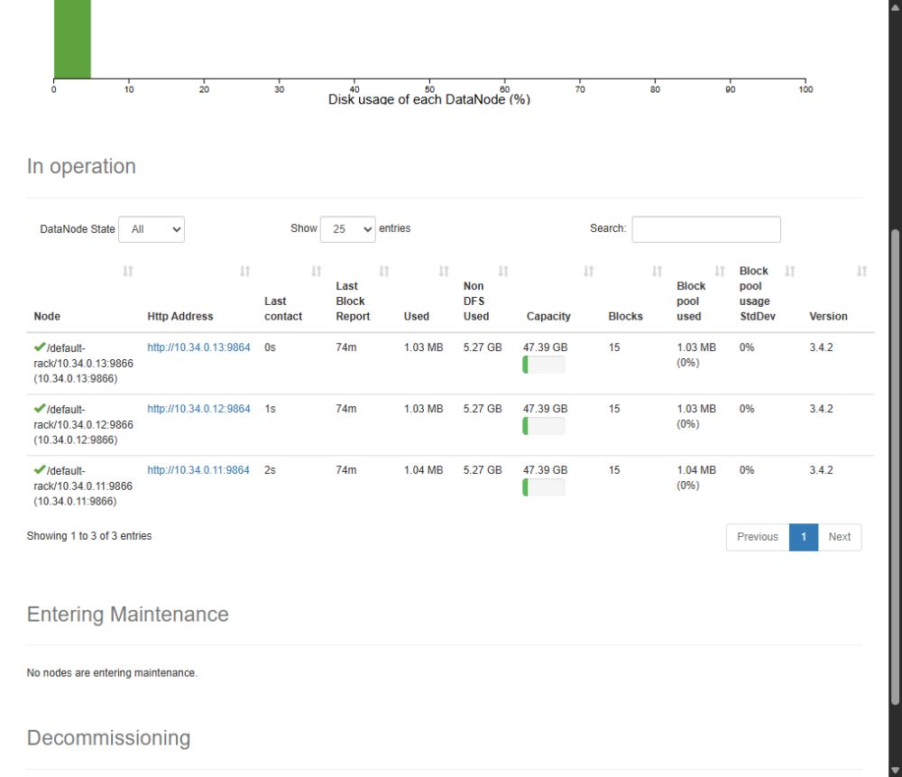

# ДЗ №1. Развёртывание HDFS

В этом задании я развернул HDFS на четырёх виртуальных машинах команды team-34: NameNode, SecondaryNameNode и три DataNode. Установку автоматизировал Bash-скриптами, а последовательность действий описал в [INSTALL.md](INSTALL.md).

## Стенд

Использовал Ubuntu 24.04, OpenJDK 11 и Hadoop 3.4.2. На каждой ВМ — 2 vCPU, около 4 GiB оперативной памяти и 48 GiB диска.

| Машина | Внутренний IP | Роль |
|---|---|---|
| team-34-en | 10.34.0.10 | edge, SecondaryNameNode |
| team-34-nn | 10.34.0.11 | NameNode, DataNode |
| team-34-00 | 10.34.0.12 | DataNode |
| team-34-01 | 10.34.0.13 | DataNode |

Внешний адрес edge — `111.88.130.214`. Внутренние машины доступны через него по SSH. NameNode и DataNode разместил на одной ВМ, чтобы на четырёх машинах получить три узла хранения и вынести SecondaryNameNode на отдельную машину. SecondaryNameNode создаёт checkpoint метаданных; резервным NameNode с автоматическим переключением он не является.

## Установка и настройки

Развёртывание запускал с edge из `/home/team/hw1-hdfs`:

```bash
bash scripts/deploy.sh
```

Скрипт скачивает Hadoop из архива Apache, проверяет SHA-512 дистрибутива и устанавливает его на все узлы. Для запуска демонов создал системного пользователя `hadoop`. Дистрибутив находится в `/opt/hadoop-3.4.2`, ссылка `/opt/hadoop` указывает на него.

Конфигурацию вынес в `/etc/hadoop`. В `core-site.xml` задал `fs.defaultFS=hdfs://10.34.0.11:9000`, в `hdfs-site.xml` — репликацию 3, адреса служб и каталоги хранения. Метаданные NameNode находятся в `/var/lib/hadoop-hdfs/namenode`, блоки DataNode — в `/var/lib/hadoop-hdfs/datanode`, checkpoint — в `/var/lib/hadoop-hdfs/secondary`.

Демоны запускаются через systemd: `hadoop-namenode`, `hadoop-datanode` и `hadoop-secondarynamenode`. Службы включены в автозапуск. Для NameNode выделил heap 768 MiB, для DataNode и SecondaryNameNode — по 512 MiB.

Форматирование NameNode выполняется только при первой установке в пустой каталог. Наличие `current/VERSION` означает, что namespace уже создан. Если каталог непустой, но VERSION отсутствует, скрипт останавливается. Так повторный запуск установки не уничтожает существующую файловую систему.

Адреса машин, внутренний SSH-ключ и версия Hadoop задаются в [cluster.env](cluster.env). Для другого стенда параметры можно переопределить в `cluster.local.env`; этот файл исключён из Git. Полная последовательность установки и команды управления службами находятся в [INSTALL.md](INSTALL.md).

## Проверка работы

После установки выполнил `scripts/verify.sh`: записал в HDFS тестовый файл, прочитал его обратно и сравнил содержимое. Проверка завершилась `VERIFY_OK`. Затем повторно запустил установку и убедился, что идентификаторы namespace и ранее записанный файл сохранились.

В HDFS остались два тестовых файла:

```text
/hw1-check/check-20261011T160449Z-18950.txt
/hw1-check/check-20261011T160737Z-29479.txt
```

У каждого файла один блок и три реплики на разных DataNode. `fsck` показал `HEALTHY`: потерянных, повреждённых и недореплицированных блоков нет. Safe mode выключен. В интерфейсе NameNode отображаются три работающих DataNode, без dead и stale узлов.



В логах при функциональной проверке критических сообщений ERROR/FATAL не было. SecondaryNameNode создал непустые файлы `fsimage`. Результаты сохранены в [verification.txt](evidence/verification.txt), [secondary-checkpoint.txt](evidence/secondary-checkpoint.txt) и [idempotence.txt](evidence/idempotence.txt).

11.10.2026 в 20:14 МСК дополнительно выполнил `scripts/review.sh`. Он подтвердил состояние active/enabled у всех служб, три живых DataNode, отсутствие ошибок томов и проблем с репликацией, целостность HDFS и наличие checkpoint. Вывод — [review.txt](evidence/review.txt).

## Что пришлось исправить

В `/etc/hosts` собственное имя машины было связано с `127.0.1.1`. Из-за этого Hadoop мог использовать loopback вместо внутреннего адреса узла. Я исправил привязку имени к IP сети `10.34.0.0/24` и явно задал внутренние адреса служб. Исправление включил в `node-setup.sh`; исходный `/etc/hosts` сохраняется как `/etc/hosts.hw1-backup`.

Скрипты находятся в [scripts/](scripts/), результаты команд — в [evidence/](evidence/). [Условие задания на сайте курса](https://go.teachbase.ru/education/listener/course_player/sessions/1415858/tasks/412727).

## Репозитории сдачи

- [ДЗ №1 — HDFS](https://github.com/zarmeux/hw1-hdfs).
- [ДЗ №2 — YARN и веб-интерфейсы](https://github.com/zarmeux/hw2-yarn).
